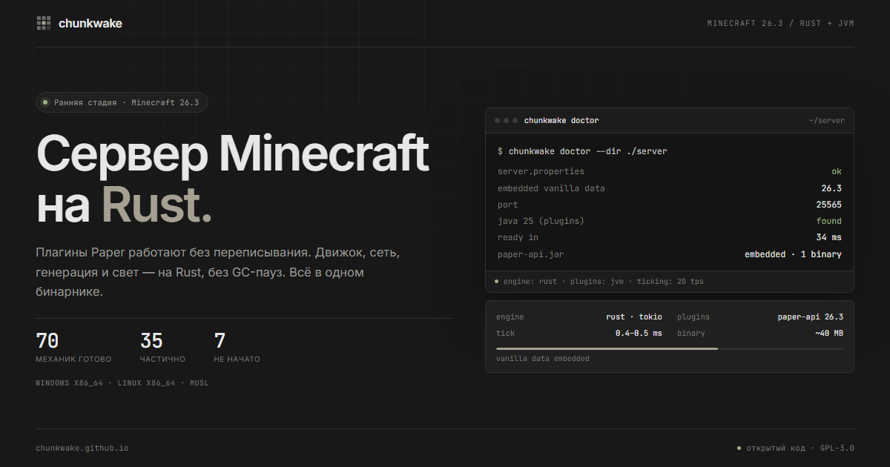
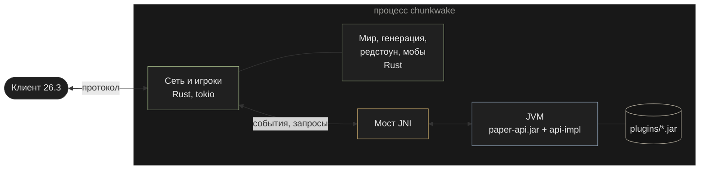

<div align="center">

<a href="https://chunkwake.github.io/ru/"></a>

# Chunkwake

**Серверное ядро Minecraft Java Edition 26.3, написанное с нуля на Rust.<br>
Ванильное поведение 1 в 1 и плагины Paper и Folia без переписывания.**

[](https://github.com/chunkwake/core/actions/workflows/ci.yml)
[](LICENSE)


[Быстрый старт](#быстрый-старт) ·
[Что уже работает](#что-уже-работает) ·
[Плагины](#плагины) ·
[Архитектура](#архитектура) ·
[Участие](#участие) ·
[Сайт](https://chunkwake.github.io/ru/) ·
[English](#english)

<a href="https://chunkwake.github.io/ru/">
  
</a>

<sub><a href="https://chunkwake.github.io/ru/">chunkwake.github.io</a></sub>

</div>

---

> [!WARNING]
> **Ранняя стадия.** Chunkwake уже держит выживание с генерацией мира, редстоуном,
> мобами и плагинами, но это ещё не замена Paper на живом сервере. Что готово и
> чего нет — в [фич-матрице](docs/feature-matrix.md), там всё честно.
> Делайте резервные копии миров.

## Зачем ещё одно ядро

У владельца сервера сейчас неприятный выбор:

| | Совместим с плагинами | Многопоточный |
|---|:---:|:---:|
| **Paper** | ✅ | ❌ один главный поток |
| **Folia** | ⚠️ только плагины с `folia-supported` | ✅ |
| **Chunkwake** | ✅ обычные плагины работают как в Paper | 🚧 движок на Rust, параллелизм — по этапам |

Chunkwake убирает этот выбор. Движок, сеть, генерация, свет и хранилище — на
Rust, без GC-пауз. Плагины — в настоящей JVM рядом с ним, на настоящем
`paper-api.jar`. Плагин не знает, что сервер не на Java.

Два правила, по которым принимаются решения:

1. **Совместимость важнее скорости.** Если быстрее значит «плагин увидит другой
   порядок событий», выбираем Paper-семантику.
2. **Ваниль — эталон, а не вдохновение.** Поведение сверяется с байткодом
   `server.jar` и Paper, а не с вики. Отличие от ванили — это баг.

## Что уже работает

По [фич-матрице](docs/feature-matrix.md): **70** семейств механик готово,
**35** частично, **7** не начато. Протокол, чанки, Anvil, инвентарь, крафт,
печи, чары и жидкости описаны отдельно в [этапах](docs/milestones.md).

<table>
<tr>
<td valign="top" width="50%">

**🌍 Мир**
- Ванильная генерация оверворлда: рельеф, акиферы, 6 осей климата, пещеры, руды, деревья
- Деревни, аванпосты и другие структуры (частично)
- Нижний мир и Край со своей генерацией
- Миры Anvil (`.mca`), читаемые ванилью в обе стороны, сжатие deflate / lz4 / без сжатия
- Свет неба и блоков, граница мира, точка спавна по рельефу

**⚡ Механики**
- Редстоун: провода, поршни, повторители, компараторы, наблюдатели, раздатчики, лектор
- Жидкости, огонь, листва, рост растений и случайные тики
- Мобы, снаряды, лук, арбалет, сферы опыта
- Наковальня, точило, крафтер, печи, станции
- Таблички (с редактором и воском), книги (запись, подпись, чтение)

</td>
<td valign="top" width="50%">

**🧩 Плагины**
- Настоящий `paper-api.jar` в JVM внутри процесса сервера
- События Bukkit и Paper в порядке Paper, отмена и подмена данных
- Планировщики Folia: глобальный, региональный, асинхронный и сущности
- `plugin.yml` и `paper-plugin.yml`, `libraries:` из Maven, `loader` и `bootstrapper`
- Миры, PDC, Metadatable, реестры, теги, атрибуты, каналы плагинов
- Ванильные классы `net.minecraft.*` в classpath для плагинов с NMS

**🛠️ Эксплуатация**
- Один бинарник со встроенными данными игры и API плагинов
- Мастер настройки в терминале, `doctor`, `config set`
- Резервные копии с проверкой контрольных сумм и откатом
- Встроенный дашборд метрик
- Ванильные команды с деревом, сверенным с `commands.json`

</td>
</tr>
</table>

## Цифры

Ryzen 9 7945HX, release-сборка, Java 25 у ванили. Сравнение с `server.jar` 26.3 —
[стенд `chunkwake-lab`](docs/lab.md): оба сервера на одной машине, плоский мир,
обзор 2, 20 ботов, разминка 20 с, замер 45 с, по два прогона. Методика и сырые
данные — в [docs/perf.md](docs/perf.md).

| Замер | Chunkwake | Ваниль |
|---|---|---|
| Запуск сервера | **0.6–0.9 с** | 6.6–11 с |
| Вход 20 ботов разом, p95 | **11–26 мс** | 845–860 мс |
| MSPT: 20 ботов ходят | **0.4–0.5 мс** | 2.7–3.1 мс |
| MSPT: 20 ботов исследуют мир | **0.8 мс** | 3.4–4.3 мс |
| MSPT: 128 ламп и проводов, переключение раз в секунду | **0.4–0.5 мс** | 3.4–3.5 мс |
| 2500 коров: TPS / MSPT | **20 / 3.9–5.6 мс** | 4.4–8.6 / 120–221 мс |
| Пик памяти процесса | **182–236 МиБ** | 845–913 МиБ |
| 400 тиков при `randomTickSpeed` 4096 | **32.5–33.5 с** | 43 с |
| Полный чанк на диске, deflate 6 | **6.9 КБ** | 8.7 КБ |

> [!NOTE]
> ИИ коров у Chunkwake ещё не сверен с ванилью до конца, поэтому строка с коровами
> сравнивает нагрузку от одинакового числа сущностей, а не одинаковую работу.
> Память ванили — это куча JVM с настройками по умолчанию, а не её минимум.

Внутренние замеры без пары у ванили: пустой тик — 51 нс (criterion), генерация
чанков — 364.6 чанка/с на 31 потоке, `/fill` 32×16×32 — 35 мс.

Скорость — вторая цель. Каждая оптимизация проверяется тем же сравнением с
`server.jar`: например, после ускорения листвы проба совпадает с ванилью построчно,
а хэш сгенерированного мира не меняется.

## Быстрый старт

### Готовый бинарник

CI собирает полный релиз под **Windows x86_64** и **Linux x86_64** (musl,
работает на любом дистрибутиве и в контейнере). Скачайте последний артефакт
`chunkwake-26.3-<os>-<arch>` со страницы
[Actions](https://github.com/chunkwake/core/actions/workflows/ci.yml): нужен вход в GitHub.
Внутри один файл. `server.jar` и Java для запуска не нужны.

```bash
chunkwake setup --dir ./server    # мастер настройки в терминале
chunkwake doctor --dir ./server   # проверка конфигурации, порта и Java
chunkwake --dir ./server          # запуск
```

Плагины кладутся в `server/plugins/`. Для них нужна **Java 25+**: сервер
найдёт её по `java-path`, `CHUNKWAKE_JAVA` или `PATH`.

### Из исходников

Нужны Rust stable и JDK 21+ (Java-экстракторы данных собираются при сборке).

```bash
git clone https://github.com/chunkwake/core.git chunkwake
cd chunkwake
cargo build --release -p chunkwake-server
```

Бинарник появится в `target/release/chunkwake`. Данные игры встраиваются в
него при сборке. Если их нет, `build.rs` возьмёт кэш или соберёт его из `server.jar`.

Служба systemd, Windows-служба, логи, `CHUNKWAKE_HOME`, резервные копии и все
переменные сборки — в [docs/running.md](docs/running.md).

## Плагины



- **JVM внутри процесса.** Сервер поднимает её через JNI. Плагины получают
  `Bukkit.getServer()`, `JavaPlugin`, события и планировщики, как в Paper.
- **API не переписан.** В classpath лежит официальный `paper-api.jar`. Реализуется
  только поведение, поэтому сигнатуры всегда совпадают с Paper.
- **События дёшевы.** Если на событие нет слушателей, Rust его не отправляет в JVM.
- **Folia.** `GlobalRegionScheduler`, `RegionScheduler`, `AsyncScheduler` и
  `EntityScheduler` работают для всех плагинов. Обычные плагины не отключаются, как в Folia.
- **ViaVersion.** ViaVersion, ViaBackwards и ViaRewind из `plugins/` пускают
  клиентов других версий (частично).

> [!NOTE]
> Граница совместимости — плагины, которые лезут во внутренности сервера
> (NMS и CraftBukkit, пакеты Netty, `ServerLevel`). Ванильные классы для них
> лежат в classpath, и часть таких плагинов работает. Полностью этого без
> Java-сервера не сделать, и мы не обещаем обратного.

## Как проверяется «1 в 1»

Ваниль здесь — исполняемый эталон.

- **Байткод.** Перед реализацией механики читаем `server.jar` и Paper через
  `javap`: константы, порядок проверок, ключи сообщений.
- **Тесты паритета.** Дерево команд сверяется с `reports/commands.json`,
  пакеты — с `reports/packets.json`. Рельеф генерации (камень, вода, лава) сверяется с ванилью, а хэш мира ловит регрессии.
- **Боты-пробы.** [`crates/bots`](crates/bots/examples) подключаются к Chunkwake и
  к `server.jar` и сравнивают пакеты построчно: листва, редстоун, чанки,
  слежение за сущностями.
- **Лаборатория.** `chunkwake-lab compare` гоняет сценарии на обоих серверах и
  собирает HTML-отчёт с отличиями, `bench` — нагрузку с ботами.
  Подробности — в [docs/lab.md](docs/lab.md).

## Архитектура

```text
crates/
├── protocol    пакеты 26.3, VarInt, NBT, текстовые компоненты, компоненты предметов
├── net         соединения, игра, команды, механики, плагинные события
├── worldgen    ванильный генератор: шум, биомы, поверхности, карверы, структуры
├── world       чанки, палитры, Anvil, свет
├── data        встроенные данные игры
├── datacache   сборка кэша данных из server.jar
├── bridge      JVM через JNI, встроенный API плагинов
├── server      бинарник chunkwake: CLI, мастер настройки, консоль, бэкапы
├── metrics     метрики и дашборд
├── lab         сравнение с ванилью и нагрузочные тесты
└── bots        боты-пробы для сверки с server.jar
java/
├── api-impl    реализация Bukkit / Paper / Folia API поверх Rust
└── test-plugin плагин для живых проверок событий
```

Около 170 тыс. строк Rust и 14 тыс. строк Java.

Дальше по [ARCHITECTURE.md](ARCHITECTURE.md) — то, чего нет ни в одном ядре.
Это **планы**, а не готовые фичи:

- 🧪 **STM-тик**: обычные плагины видят один главный поток, а исполняются параллельно.
- 🏝️ **Динамические острова** вместо фиксированных регионов Folia.
- 📜 **Мир как журнал событий**: откат и повтор изменений.
- 🔗 **Мост на Panama FFM** с общей памятью вместо JNI.

## Документация

| | |
|---|---|
| [docs/feature-matrix.md](docs/feature-matrix.md) | что готово, что частично, чего нет — построчно |
| [docs/running.md](docs/running.md) | установка, служба, логи, бэкапы, переменные сборки |
| [docs/commands.md](docs/commands.md) | ванильные команды и их отличия |
| [docs/lab.md](docs/lab.md) | сравнение с ванилью и бенчмарки |
| [docs/perf.md](docs/perf.md) | замеры CPU, памяти и диска |
| [docs/observability.md](docs/observability.md) | метрики и дашборд |
| [docs/milestones.md](docs/milestones.md) · [docs/criteria.md](docs/criteria.md) | этапы и критерии |
| [ARCHITECTURE.md](ARCHITECTURE.md) | устройство и планы |

## Участие

Pull request'ы и issue приветствуются — подробности в [CONTRIBUTING.md](CONTRIBUTING.md).
Лучшее место для начала — строки «частично» и «нет» в [фич-матрице](docs/feature-matrix.md).

```bash
cargo test -p chunkwake-world -p chunkwake-net -p chunkwake-server -p chunkwake-protocol
cd java && ./gradlew dist :api-impl:test
```

Правила:

- **Сначала ваниль.** Прочитайте нужный класс `server.jar` или Paper, а не
  угадывайте поведение. В PR напишите, с чем сверялись.
- **Тест на поведение.** Юнит-тест или проба ботом против `server.jar`.
- **Плагинное событие вместе с механикой.** Если у механики есть событие Paper,
  оно должно стрелять в том же месте и с той же отменой.
- **Матрица честная.** Сделали механику — обновите строку в
  [feature-matrix.md](docs/feature-matrix.md), включая то, чего ещё нет.
- Комментарии, документация и сообщения коммитов — на русском.

Нашли отличие от ванили или упавший плагин? Откройте
[issue](https://github.com/chunkwake/core/issues): версия, плагин, шаги и
что делает ваниль.

## Лицензия

[GNU GPL v3](LICENSE).

Chunkwake — независимый проект. Он не связан с Mojang Studios, Microsoft,
PaperMC или Folia и не одобрен ими. Minecraft — товарный знак Mojang Synergies AB.
Код Minecraft в репозитории не распространяется: данные игры извлекаются из
официального `server.jar` при сборке.

---

## English

**Chunkwake** is a Minecraft Java Edition **26.3** server written from scratch in
**Rust**. It aims for **1:1 vanilla behaviour** and runs **unmodified Paper and
Folia plugins**: a real JVM is embedded in the server process with the official
`paper-api.jar`, and the Rust core fires Bukkit/Paper events in Paper's order.

- **Status:** early. Survival with vanilla world generation, redstone, mobs and
  plugins works; see the [feature matrix](docs/feature-matrix.md) (70 done,
  35 partial, 7 not started).
- **Verified against vanilla:** mechanics are implemented from `server.jar` and
  Paper bytecode, then checked with parity tests and bots that compare packets
  with a real vanilla server.
- **Folia schedulers** work for every plugin, and regular plugins keep working.
- **One binary:** game data and the plugin API are embedded; Java 25+ is only
  needed for plugins.
- **Build:** `cargo build --release -p chunkwake-server`, then
  `chunkwake setup --dir ./server` and `chunkwake --dir ./server`.

Docs and commit messages are in Russian; issues and PRs in English are welcome.
Licensed under GPLv3. Not affiliated with Mojang, Microsoft or PaperMC.
